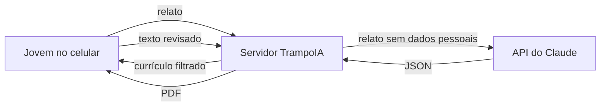

# TrampoIA

Página web gratuita que ajuda jovens da periferia de Salvador a montar o primeiro currículo. A pessoa conta o que já fez com as próprias palavras ("ajudo minha tia no salão, atendo as clientes e marco horário no zap") e recebe um currículo em linguagem de RH, junto com 3 a 5 perguntas comuns de entrevista e orientação de como responder a cada uma.

Projeto de extensão da disciplina Tecnologias e Inteligências Artificiais, da Universidade Católica do Salvador, semestre 2026.2. Orientador: Prof. Igor Gonçalves da Silva.

## O problema

Estudantes de escola pública disputam vagas de Jovem Aprendiz, estágio e primeiro emprego sem o vocabulário que os filtros automáticos de currículo (ATS) procuram. Muitos caem na primeira triagem mesmo com experiência real, como ajudar no negócio da família ou assumir responsabilidades na comunidade. Os sites de currículo cobram na hora do download, e os chatbots abertos pedem que a pessoa saiba escrever prompt e às vezes inventam qualificações.

No TrampoIA a pessoa só preenche um formulário. O prompt fica do nosso lado, e um filtro tira do resultado o que ela não contou.

## Escopo do MVP

Uma página, um formulário e uma tela de resultado. Os testes com estudantes estão previstos para novembro de 2026, então ficou só o que esse teste precisa.

O MVP tem:

- formulário com escolaridade, vivências, voluntariado, oficinas e objetivo profissional;
- geração do currículo e das perguntas de entrevista em uma única chamada à API do Claude;
- Filtro de Integridade, que descarta o que não tem origem no relato;
- tela de revisão, onde a pessoa corrige o texto antes de exportar;
- exportação em texto copiado e em PDF leve;
- layout para celular popular em 3G ou 4G.

Não entram nesta versão: escolha de modelo visual, foto, simulação de entrevista por chat ou voz, busca de vagas, leitura de currículo já existente, aplicativo nativo e painel administrativo. Login, banco de dados e histórico também ficam de fora, porque o público inclui adolescentes e o projeto se compromete a não guardar dados pessoais.

## Como funciona

O navegador manda o relato para o nosso servidor, que apaga CPF, telefone e e-mail que tenham sido digitados no texto e chama o Claude. A resposta passa pelo filtro e volta para a tela de revisão. Nome e contato não vão para o modelo: só saem do navegador quando a pessoa pede o PDF.



## Tecnologia

| Parte | Escolha | Por quê |
|---|---|---|
| Página | HTML, CSS e JavaScript puros | Até 50 KB no total, para abrir em 3G |
| Servidor | Um processo Node.js com Express | Guarda a chave da API, que não pode ir para o navegador |
| IA | API do Claude, modelo `claude-opus-5-5` | Saída em JSON validada por esquema |
| PDF | PDFKit, no servidor | Arquivo pequeno, com texto selecionável para o ATS |
| Dados | Nenhum banco | O que a pessoa digita fica na memória da aba |

Qualquer serviço que rode Node serve para hospedar. O servidor precisa aguentar requisições de até 90 s, o que descarta planos de função serverless com prazo curto.

## Documentação

| Arquivo | Conteúdo |
|---|---|
| [docs/requisitos.md](docs/requisitos.md) | Requisitos funcionais e não funcionais, perguntas do formulário, validação com estudantes |
| [docs/regras-de-negocio.md](docs/regras-de-negocio.md) | Regras de integridade, privacidade, conteúdo e limites de uso |
| [docs/validacoes.md](docs/validacoes.md) | Validação de campos, filtro, PDF e mensagens de erro |
| [docs/integracao-claude.md](docs/integracao-claude.md) | Requisição, prompt, esquema de saída e custo |
| [docs/diagramas.md](docs/diagramas.md) | Casos de uso, contexto, fluxo, sequência, filtro, estados e contrato de dados |

## Estado atual

O repositório tem só a documentação, e o código ainda não foi escrito. A organização prevista é esta:

```text
public/    index.html, estilo.css, app.js
server/    index.js, validar.js, filtro.js, claude.js, pdf.js
prompts/   sistema.md
docs/
```

## Pendências

- Atualizar o texto do projeto na entrega final: a API do Claude não aceita mais o parâmetro de temperatura citado nas seções 3 e 6. A explicação está em [integracao-claude.md](docs/integracao-claude.md#temperatura).
- Confirmar com o orientador se as oficinas precisam de termo de assentimento dos estudantes e de autorização dos responsáveis, já que parte do público é menor de idade.
- Confirmar a escola ou polo social que recebe as oficinas da Fase 2.
- Decidir se vale pedir retenção zero à Anthropic. O projeto fala em operação sem persistência, o que vale para o TrampoIA, mas as entradas da API ficam com a Anthropic por até 30 dias. O aviso de privacidade já informa esse prazo.

## Equipe

Alice Pimentel Monteiro, Diego Peon San Martin Neto, Luana Leal da Glória, Maria Clara de Barros dos Santos, Maria Vitória Santana Moura, Matheus Bastos Barbosa, Pedro Henrique Santos Cardoso Fernandes e Zaira Dutra Pinto Souza.
