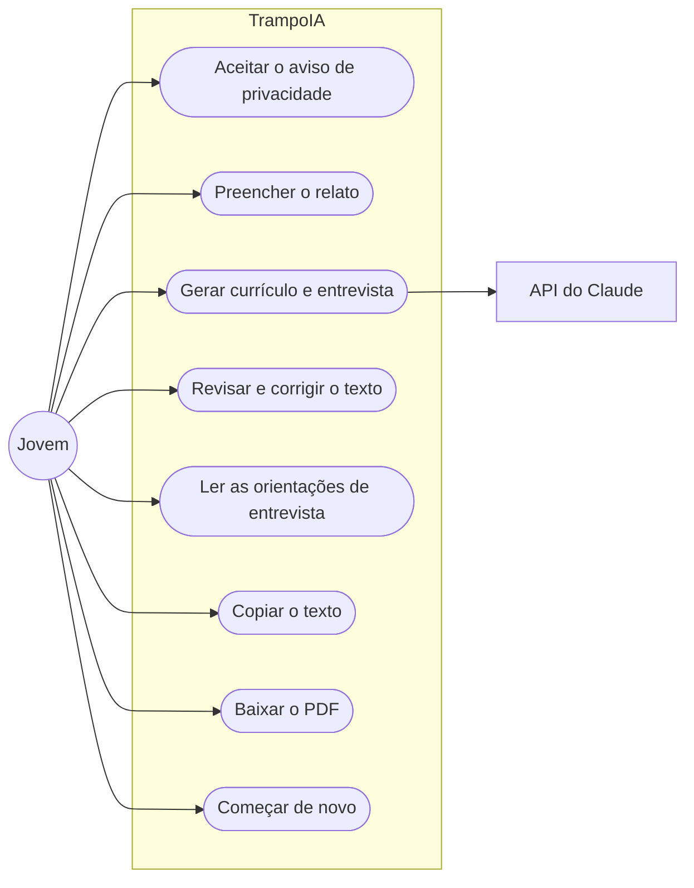
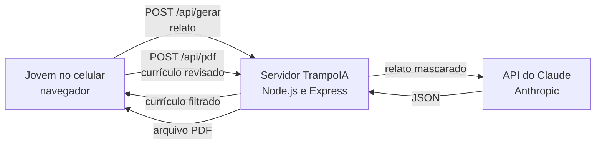
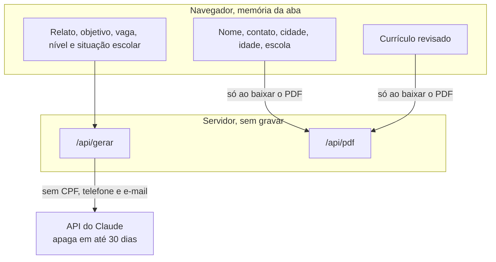
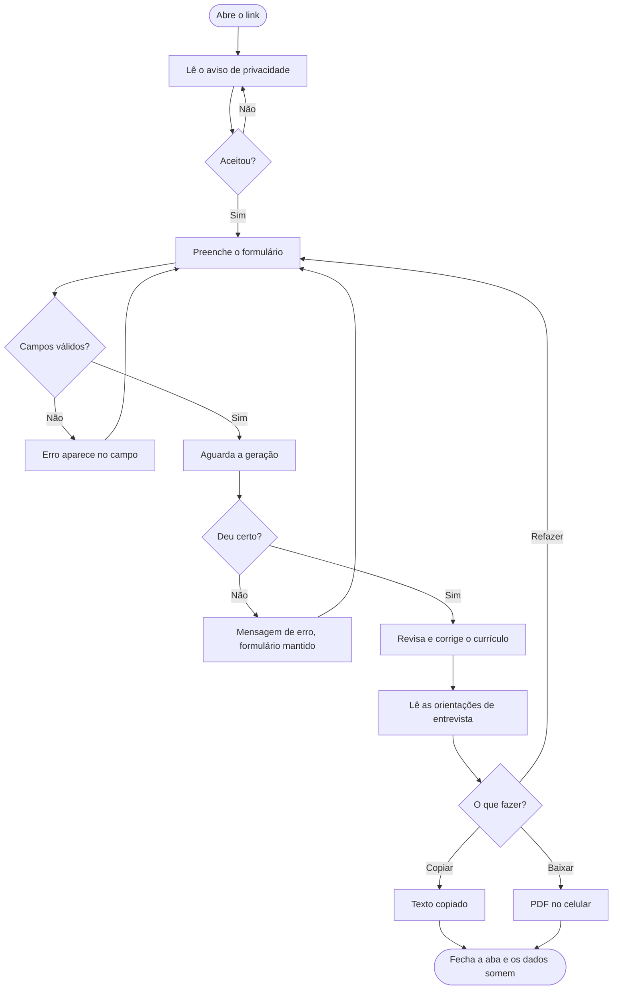
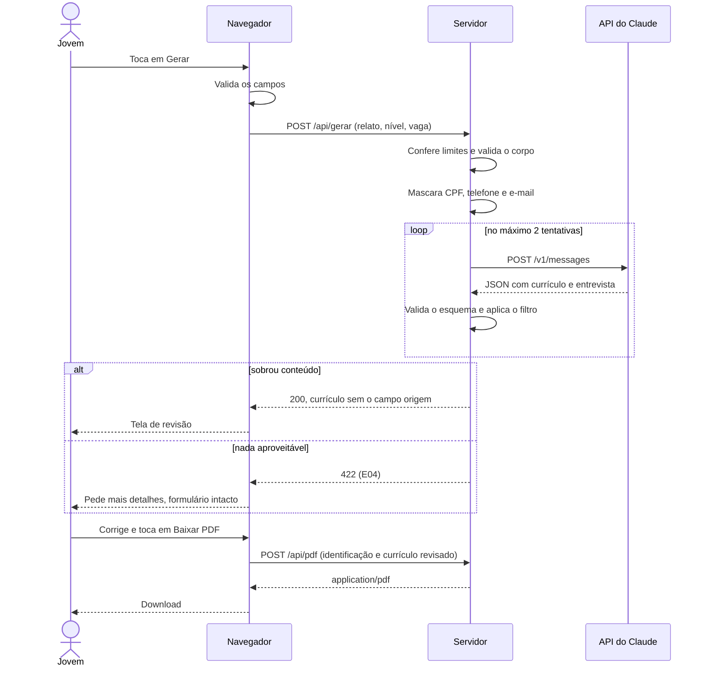
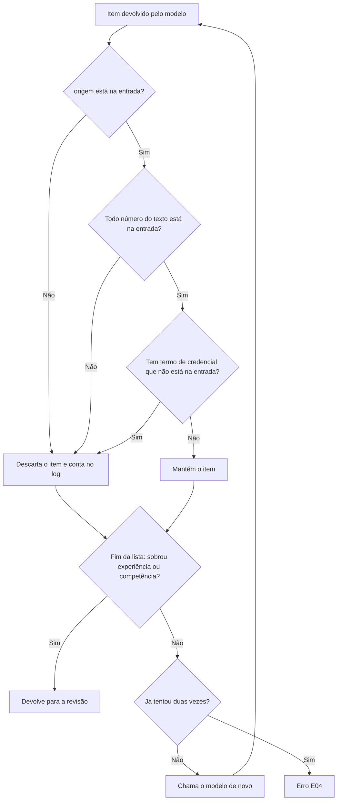
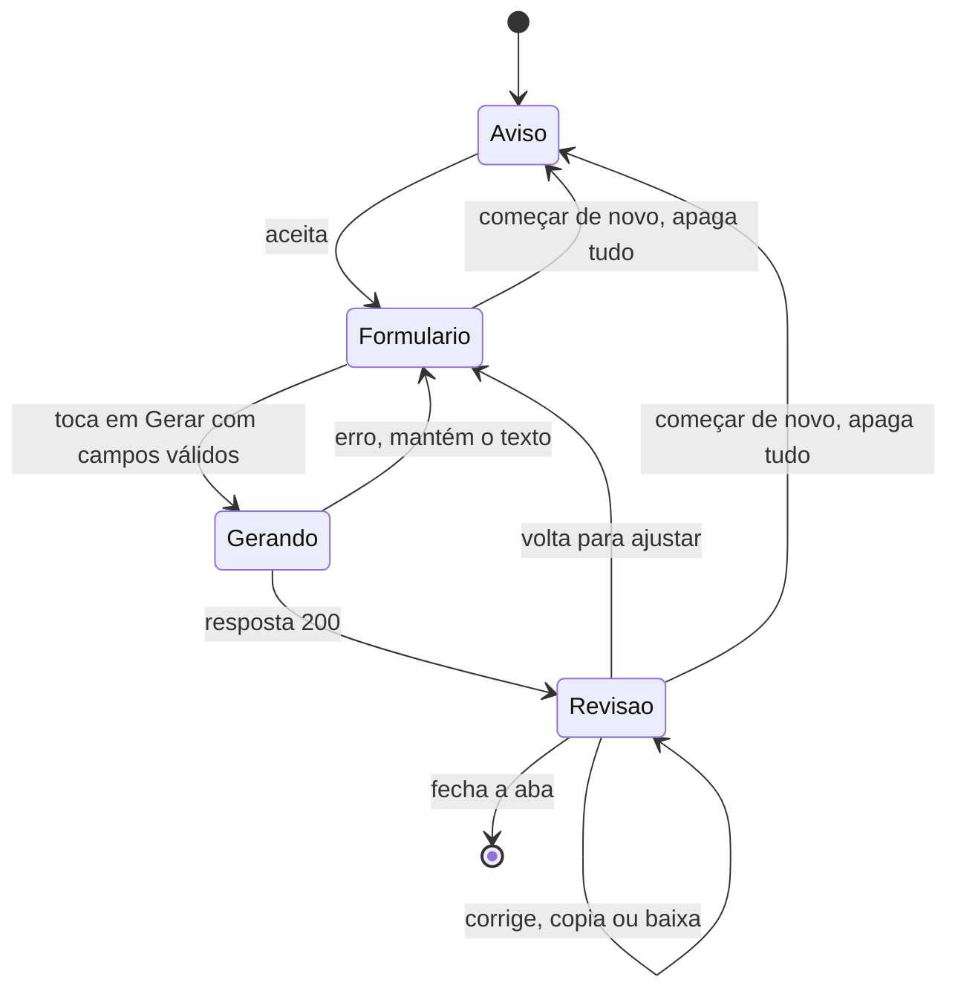
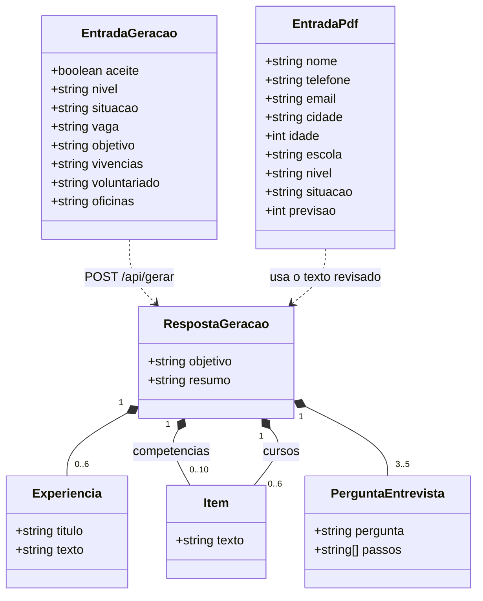

# Diagramas

Escritos em Mermaid, que o GitHub desenha direto no Markdown. Os códigos RN, V e E vêm de [regras-de-negocio.md](regras-de-negocio.md) e [validacoes.md](validacoes.md).

## Casos de uso

Há um só ator humano. A API do Claude entra como sistema externo na geração.

## Contexto

## Para onde vai cada dado

Nome e contato só saem do navegador quando a pessoa pede o PDF, e nunca chegam ao modelo (RN13). O servidor não grava nada em nenhuma das rotas (RN12).

## Fluxo de uso

## Sequência da geração

## Filtro de Integridade

## Estados da tela

## Contrato de dados

Não há banco. São os objetos que trafegam nas duas rotas.

No retorno do modelo, `Experiencia` e `Item` têm também o campo `origem`, que o servidor retira antes de responder ao navegador.
